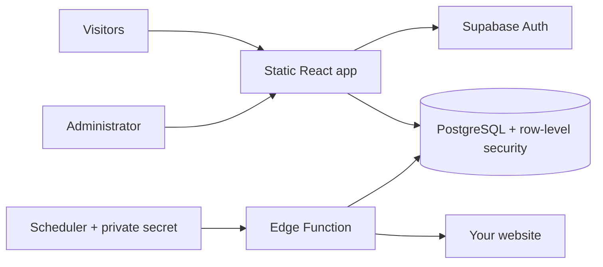

<p align="center">
  
</p>

<p align="center">
  <a href="https://github.com/kaveeshapansilu/watchpost/actions/workflows/ci.yml"></a>
  <a href="LICENSE"></a>
  <a href="package.json"></a>
</p>

<p align="center">
  A self-hosted status page that keeps people in the loop.<br />
  Website monitoring, incident updates, and maintenance plans. All in your own stack.
</p>

<p align="center">
  <a href="#quick-start">Get started</a> ·
  <a href="docs/DEPLOYMENT.md">Deploy</a> ·
  <a href="#make-it-yours">Customize</a> ·
  <a href="CONTRIBUTING.md">Contribute</a>
</p>

## The idea

Downtime happens. Leaving people guessing doesn't have to.

Watchpost gives your website a public home for availability updates, incident timelines, and planned maintenance. You own the deployment, the database, and the branding. No tracking scripts. No Watchpost account to sign up for.

**One installation monitors one website using its own Supabase project.** This is a self-hosted app, not a multi-tenant monitoring platform.

## A quick look


*Preview with sample data. A fresh deployment starts empty.*

## What ships

| Feature | What you get |
| --- | --- |
| Public status | A clear headline, website availability history, and automatic refreshes |
| Incident updates | Severity, status changes, timestamps, and a public timeline |
| Grouped maintenance | One main plan with multiple items, visitor details, and optional item schedules |
| Published-plan editing | Update titles, descriptions, times, and items without losing completion state |
| Item completion | Complete or reopen items separately, with green ticks and a progress count |
| Website monitoring | Scheduled HTTPS checks from a Supabase Edge Function |
| Your branding | Website name, logo, colors, contact link, page metadata, and admin route |
| Admin access | Supabase Auth plus database-enforced permissions |

## Quick start

You'll need **Node.js 22.18+**, npm, a new Supabase project, and an HTTPS static host. CI checks Node 22 and 24.

### 1. Clone and configure

```bash
git clone https://github.com/kaveeshapansilu/watchpost.git
cd watchpost
npm ci
npm run setup
```

The setup wizard asks for your website, branding, and public Supabase connection settings. It creates three files:

| File | Contents | Commit it? |
| --- | --- | --- |
| `site.config.json` | Public website and branding settings | Yes, in your own deployment repo |
| `.env` | Public Supabase URL and publishable or anon key | No, ignored by Git |
| `supabase/.env.monitor.local` | Website target and a generated private monitor secret | Never |

You can skip the Supabase connection during setup and add it later. Without a connection, the app shows setup instructions instead of claiming your website is online.

### 2. Create the database

In your new Supabase project's SQL Editor, run [`supabase/schema.sql`](supabase/schema.sql).

`Success. No rows returned` is expected. The baseline includes all current features. A fresh installation does not need the historical migrations separately.

### 3. Create your admin

Disable public signup in Supabase Auth. Create a user in **Authentication → Users**, copy their user ID, and run:

```sql
update public.profiles
set role = 'admin'
where id = 'YOUR_AUTH_USER_UUID';
```

Confirm that one row was updated. If you created the user before running the schema, use the [profile bootstrap instructions](docs/DEPLOYMENT.md#1-configure-the-website-and-database).

Configure Supabase Auth's **Site URL** with your status page's HTTPS origin. Use a publishable or legacy anon key for the frontend. The build rejects secret and service-role keys.

### 4. Run it locally

```bash
npm run dev
```

Open the local URL shown in your terminal. Sign in at `/admin/login`, or at your configured admin path followed by `/login`.

### 5. Turn monitoring on and deploy

Follow the [deployment guide](docs/DEPLOYMENT.md) to deploy the protected monitor and schedule checks. Then:

```bash
npm run build
```

Deploy the **contents of `dist/`** to your HTTPS host. Apache/cPanel, Netlify, and Vercel setup are covered in the guide. Static hosting serves the app; Supabase provides Auth, data storage, and the monitor.

## Make it yours

Edit [`site.config.json`](site.config.json), or rerun `npm run setup`.

```json
{
  "name": "Your Website",
  "url": "https://example.com",
  "title": "Your Website Status",
  "description": "Service availability, incidents, and planned maintenance.",
  "logo": "/logo.svg",
  "contactUrl": "mailto:hello@example.com",
  "primaryColor": "#0f766e",
  "accentColor": "#0f766e",
  "adminPath": "/admin"
}
```

- **Logo:** add your asset to `public/`, then reference it by root path. An HTTPS image URL also works. Leave it blank to use an initial.
- **Contact:** use an HTTPS or `mailto:` link. Leave it blank to hide the button.
- **Colors:** use six-digit hex values. Pick a primary color that stays readable with white text.
- **Favicon:** replace `public/favicon.svg` with your own icon.
- **Admin path:** use a single route segment. Its name is not a security boundary; authentication and database policies handle access.

Rebuild after frontend configuration changes. When changing the monitored website, run `npm run monitor:env` and upload the refreshed monitor settings too. Use a fresh database or clear the old uptime history before switching to a different service.

## How it fits together



The browser uses a public Supabase key. Database policies allow public status reads and restrict changes to administrators. The monitor uses server-side credentials and checks a separate private Bearer secret before making a request.

## A few things to know

- **The headline is editorial.** Manual status takes priority, followed by active maintenance and unresolved incidents. A failed probe records downtime; it does not create an incident or change the manual status automatically.
- **Uptime is sample-based.** The chart uses recorded checks. Missing samples are not counted as successful requests, and percentages are not an SLA calculation.
- **Checks run from one region.** This is not multi-region monitoring or a visitor-side reachability check.
- **Times are local to the visitor.** Daily uptime buckets use UTC.
- **Completion is per item.** Mark the overall maintenance window completed separately when the full plan is finished.
- **Two-minute checks are the default.** Faster schedules may require raising the frontend's 25,000-record history limit.

## Developer workflow

```bash
npm ci
npm run check       # lint, tests, and production build
npm run dev         # local app
npm run preview     # preview the production build
```

Tests cover configuration validation, public-key restrictions, monitor authorization, probe results, and maintenance payloads. CI runs the same checks on Node 22 and 24, audits dependencies, and checks the Edge Function with Deno. Database access and browser flows also need verification when changing those areas; see [contributing](CONTRIBUTING.md).

<details>
<summary><strong>Repository map</strong></summary>

```text
src/
  components/           Shared status, incident, and maintenance UI
  hooks/                Public data loading and authentication
  lib/                  Configuration, domain types, and validation
  pages/                Public pages and admin screens
supabase/
  schema.sql            Complete fresh-install database schema
  migrations/           Incremental changes for existing installs
  functions/monitor/    Protected monitoring function
  schedule.sql          Cron schedule using Vault secrets
scripts/                Setup and monitor configuration helpers
tests/                  Node test-runner checks
docs/                   Deployment guide and project visuals
.github/                CI, dependency updates, and contribution templates
site.config.json        Public website configuration
```

</details>

## Contributing

Small, focused pull requests are welcome. Bug reports with reproduction steps are especially helpful. Check the [contribution guide](CONTRIBUTING.md), then [open an issue](https://github.com/kaveeshapansilu/watchpost/issues/new/choose) or submit a pull request.

Found a security issue? Use [private vulnerability reporting](https://github.com/kaveeshapansilu/watchpost/security/advisories/new). Please keep exploit details and live credentials out of public issues.

## License

[MIT](LICENSE). Build on it, make it yours, and keep the license notice with your copy. Dependencies retain their own licenses, listed in [third-party notices](THIRD_PARTY_NOTICES.md).

[Deployment guide](docs/DEPLOYMENT.md) · [Security policy](SECURITY.md) · [Changelog](CHANGELOG.md)
